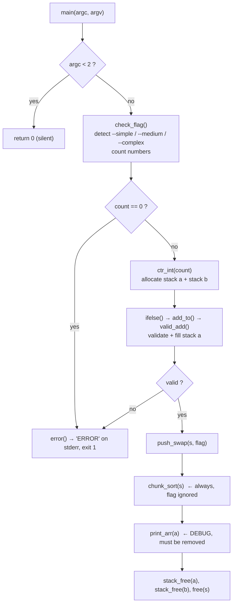
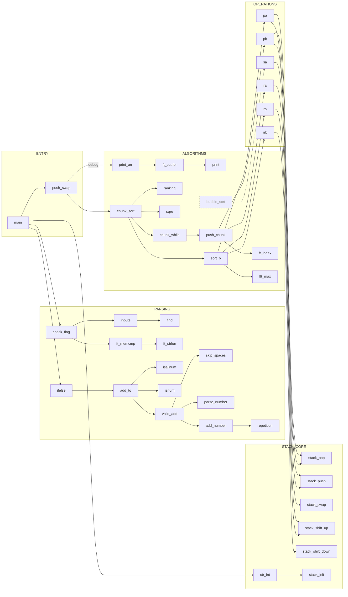

<div align="center">

# push_swap — Project Status & Code Map

**Where we are, what works, what is missing, and where every function lives.**


*Snapshot analysed: `send-main.zip` · 26 Nov 2026 · every claim below was verified by compiling and running the code, not guessed.*

</div>

---

## Table of contents

1. [Status dashboard](#1-status-dashboard)
2. [Progress checklist](#2-progress-checklist)
3. [Repository layout](#3-repository-layout)
4. [How the program runs (flow)](#4-how-the-program-runs-flow)
5. [Function map (all 49 functions)](#5-function-map-all-49-functions)
6. [Call graph](#6-call-graph)
7. [Formula decoder (the confusing maths)](#7-formula-decoder-the-confusing-maths)
8. [How our chunk sort works](#8-how-our-chunk-sort-works)
9. [Measured results](#9-measured-results)
10. [Known issues (prioritised)](#10-known-issues-prioritised)
11. [Roadmap](#11-roadmap)
12. [Testing cookbook](#12-testing-cookbook)
13. [Glossary](#13-glossary)

---

## 1. Status dashboard

| Area | State | Evidence |
|---|---|---|
| Compiles | ✅ | `gcc -Wall -Wextra -Werror -I.` → 0 warnings |
| Input parsing (ints, quotes `"1 2"`, `+`/`-`, overflow, duplicates) | ✅ | tested: `1 2 a`, `1 2 2`, `99999999999`, `2147483648` → error; `-2147483648` accepted |
| The 11 operations (`sa sb ss pa pb ra rb rr rra rrb rrr`) | ✅ implemented | all exist; only `pa pb ra rb rrb` are *used* by a sort |
| Sorting is **correct** | ✅ | `checker_linux` → `OK` on n = 3, 5, 10, 100, 500 (random + reversed) |
| Sorting is **efficient** | ⚠️ weak | n=100 ≈ 750–830 ops · n=500 ≈ 8 000–8 100 ops (see [§9](#9-measured-results)) |
| Strategy flags `--simple/--medium/--complex` | ❌ parsed, **ignored** | `push_swap()` always calls `chunk_sort` |
| `--complex` (O(n log n)), `--adaptive`, `--bench` | ❌ not started | no code exists |
| Clean stdout (only operations) | ❌ | a debug line `1, 2, 3, ` is printed after the ops → **breaks the checker** |
| Memory | ⚠️ | 1 leak (`ranking()` result is never freed) |
| `Makefile` | ❌ missing | not in the archive |

> [!IMPORTANT]
> The two things that block us from being "submittable" today are **(1)** the debug `print_arr` line in `push_swap.c`, and **(2)** the missing strategy dispatch. Both are small fixes — see [§10](#10-known-issues-prioritised).

---

## 2. Progress checklist

> The items marked *(subject)* come from the current 42 push_swap variant (flags + bench + adaptive). **Re-check them against your own subject PDF** before treating them as final.

**Core**
- [x] Stack data structure (ring buffer, O(1) rotate)
- [x] All 11 operations implemented
- [x] Argument parsing + error handling
- [x] Duplicate / overflow detection
- [x] One working sort (chunk sort, O(n√n))
- [x] A second working sort (`bubble_sort`, O(n²)) — works, but is **not connected**
- [ ] Output contains **only** operations (remove debug print)
- [ ] `Makefile` (`all clean fclean re`, no relink)
- [ ] Memory: zero leaks
- [ ] `norminette` clean (see [§10](#10-known-issues-prioritised))

**Flags & strategies** *(subject)*
- [ ] Dispatch on `--simple` → O(n²), `--medium` → O(n√n), `--complex` → O(n log n)
- [ ] `--complex` algorithm (radix sort is the usual choice)
- [ ] Disorder metric + `--adaptive` (default mode)
- [ ] `--bench` report on **stderr**
- [ ] Parser must also accept `--adaptive` and `--bench` (today they are rejected as invalid numbers)

**Quality**
- [ ] Hard-coded fast paths for 2, 3 (and 5) numbers
- [ ] Optimise the 100 / 500 operation counts
- [ ] Automated test script ([§12](#12-testing-cookbook))

---

## 3. Repository layout

```text
send-main/
├── main.c                 parsing front-end + main()            (5 functions)
├── push_swap.c            strategy dispatcher                    (1 function)
├── header/
│   └── push_swap.h        structs + all prototypes
├── algo/
│   ├── bubble_sort.c      O(n²) sort            — NOT connected
│   └── chunk_sort.c       O(n√n) sort           — the one actually used
├── src/                   (U = utils)
│   ├── bubble_U.c         ★ number parsing (name is misleading!)
│   ├── chunk_U.c          helpers for chunk sort (sqre, ranking, fft_max, ft_index)
│   ├── main_U.c           libft-style helpers + error()
│   ├── main_U2.c          repetition, printing, ifelse
│   ├── op_stack.c         pa pb sa sb ss
│   ├── op_stack_r.c       ra rb rr rra rrb
│   ├── stack_U.c          stack creation + rotation + is_sorted
│   └── stack_U2.c         swap, free, pop, push, ★ rrr (!)
└── checker_linux          provided 42 checker binary
```

| File | Role | Fns | Created by (42 header) | Last updated |
|---|---|:-:|---|---|
| `header/push_swap.h` | structs + prototypes | – | aisfi | 26 Nov |
| `main.c` | parsing + `main` | 5 | nguerrab | 24 Nov |
| `push_swap.c` | dispatcher | 1 | nguerrab | 26 Nov |
| `algo/bubble_sort.c` | simple sort | 1 | aisfi | 24 Nov |
| `algo/chunk_sort.c` | medium sort | 4 | nguerrab | 26 Nov |
| `src/bubble_U.c` | number parser | 4 | nguerrab | 26 Nov |
| `src/chunk_U.c` | chunk helpers | 4 | nguerrab | 26 Nov |
| `src/main_U.c` | misc utils | 5 | nguerrab | 26 Nov |
| `src/main_U2.c` | misc utils 2 | 5 | nguerrab | 26 Nov |
| `src/op_stack.c` | push/swap ops | 5 | aisfi | 22 Nov |
| `src/op_stack_r.c` | rotate ops | 5 | aisfi | 22 Nov |
| `src/stack_U.c` | stack core | 5 | aisfi | 24 Nov |
| `src/stack_U2.c` | stack core 2 | 5 | nguerrab | 26 Nov |

> [!NOTE]
> **Norm limit = 5 functions per file.** Almost every file is already full. Any new algorithm (radix, adaptive, bench, small sorts) needs **new files** — plan names now (e.g. `algo/radix_sort.c`, `algo/small_sort.c`, `src/bench.c`, `src/disorder.c`).

---

## 4. How the program runs (flow)



**Flag numbering** produced by `check_flag`: `0` = no flag · `1` = `--simple` · `2` = `--medium` · `3` = `--complex`.
Only `argv[1]` is checked for a flag.

---

## 5. Function map (all 49 functions)

**Legend:** ✅ used and verified · ⚠️ used but has an issue · 💤 defined, never called · `static` = private to its file (cannot be called from other files).
Line numbers are the line of the function signature.

### 5.1 Entry & orchestration

| Function | Location | What it does | Calls | |
|---|---|---|---|:-:|
| `main` | `main.c:97` | entry point: flag → count → allocate → fill → sort → free | `check_flag` `ctr_int` `error` `ifelse` `push_swap` `stack_free` | ⚠️ |
| `push_swap` | `push_swap.c:15` | picks the algorithm (today: always chunk) | `chunk_sort` `print_arr` | ⚠️ |

### 5.2 Parsing & validation

| Function | Location | What it does | Calls | |
|---|---|---|---|:-:|
| `check_flag` | `main.c:81` `static` | sets `flag` (0–3), returns how many numbers are in the rest of argv | `ft_memcmp` `ft_strlen` `inputs` | ⚠️ |
| `inputs` | `main.c:37` `static` | total count of numbers across several args | `find` | ✅ |
| `find` | `main.c:15` `static` | counts numbers inside **one** string | – | ✅ |
| `ifelse` | `src/main_U2.c:68` | skips the flag arg(s), calls `add_to`, errors on failure | `add_to` `error` | ✅ |
| `add_to` | `main.c:52` | validates each arg, fills stack `a`; frees stacks on failure | `isallnum` `isnum` `valid_add` `stack_free` | ✅ |
| `valid_add` | `src/bubble_U.c:60` | splits one arg on spaces; parses + stores every number | `skip_spaces` `parse_number` `add_number` | ✅ |
| `skip_spaces` | `src/bubble_U.c:15` `static` | advances index past spaces | – | ✅ |
| `parse_number` | `src/bubble_U.c:21` `static` | reads a signed int with overflow guard (see [§7](#7-formula-decoder-the-confusing-maths)) | – | ✅ |
| `add_number` | `src/bubble_U.c:50` | duplicate check, then stores into `a->arr[i]` | `repetition` | ✅ |
| `repetition` | `src/main_U2.c:15` | returns **0 if duplicate**, 1 if OK (inverted name!) | – | ✅ |
| `isallnum` | `src/main_U.c:37` | arg contains only digits, spaces, `+`, `-` | – | ✅ |
| `isnum` | `src/main_U.c:54` | arg contains at least one digit | – | ✅ |
| `error` | `src/main_U.c:78` | writes `ERROR\n` to fd 2 and `exit(1)` | – | ⚠️ |

### 5.3 Algorithms

| Function | Location | What it does | Calls | |
|---|---|---|---|:-:|
| `chunk_sort` | `algo/chunk_sort.c:79` | **medium** sort entry: rank → chunks → push back | `ranking` `sqre` `chunk_while` `sort_b` `stack_is_sorted` `error` | ⚠️ leak |
| `chunk_while` | `algo/chunk_sort.c:59` `static` | loops over the `k` chunks, computes each rank range | `push_chunk` | ✅ |
| `push_chunk` | `algo/chunk_sort.c:37` `static` | scans A: rank in range → `pb`, else `ra` | `ft_index` `pb` `ra` `stack_is_sorted` | ✅ |
| `sort_b` | `algo/chunk_sort.c:15` `static` | brings the max of B to the top (`rb`/`rrb`) then `pa` | `fft_max` `rb` `rrb` `pa` | ✅ |
| `bubble_sort` | `algo/bubble_sort.c:15` | **simple** O(n²) sort | `sa` `ra` `pb` `pa` `stack_is_sorted` | 💤 works, not connected |
| `sqre` | `src/chunk_U.c:15` | number of chunks `k` ≈ √n | – | ✅ |
| `ranking` | `src/chunk_U.c:27` | builds the **sorted copy** of A (`malloc`) | – | ⚠️ never freed |
| `fft_max` | `src/chunk_U.c:54` | **physical index** of the largest value in a stack | – | ✅ |
| `ft_index` | `src/chunk_U.c:77` | position of a value inside the sorted copy = its **rank** | – | ✅ |

### 5.4 The 11 operations

| Op | Location | Behaviour | Calls | |
|---|---|---|---|:-:|
| `pa` | `src/op_stack.c:15` | top of B → top of A | `stack_pop` `stack_push` | ✅ |
| `pb` | `src/op_stack.c:27` | top of A → top of B | `stack_pop` `stack_push` | ✅ |
| `sa` | `src/op_stack.c:38` | swap top 2 of A | `stack_swap` | ✅ (bubble only) |
| `sb` | `src/op_stack.c:46` | swap top 2 of B | `stack_swap` | 💤 |
| `ss` | `src/op_stack.c:54` | `sa` + `sb` | `stack_swap` | 💤 |
| `ra` | `src/op_stack_r.c:15` | rotate A up | `stack_shift_up` | ✅ |
| `rb` | `src/op_stack_r.c:21` | rotate B up | `stack_shift_up` | ✅ |
| `rr` | `src/op_stack_r.c:27` | `ra` + `rb` | `stack_shift_up` | 💤 |
| `rra` | `src/op_stack_r.c:39` | reverse-rotate A | `stack_shift_down` | 💤 |
| `rrb` | `src/op_stack_r.c:45` | reverse-rotate B | `stack_shift_down` | ✅ |
| `rrr` | `src/stack_U2.c:45` ⚠️ | `rra` + `rrb` — **lives in the wrong file** | `stack_shift_down` | 💤 |

### 5.5 Stack core (ring buffer)

| Function | Location | What it does | Calls | |
|---|---|---|---|:-:|
| `ctr_int` | `src/stack_U.c:15` | allocates the container `{a, b}` (should be called `ctr_init`) | `stack_init` `stack_free` | ✅ |
| `stack_init` | `src/stack_U.c:38` | allocates one stack of capacity `cap` | – | ✅ |
| `stack_shift_up` | `src/stack_U.c:57` | rotate: move `head` forward, copy old top to the tail | – | ✅ |
| `stack_shift_down` | `src/stack_U.c:71` | reverse rotate: move `head` back, copy old tail to the head | – | ✅ |
| `stack_is_sorted` | `src/stack_U.c:85` | ascending from top to bottom? | – | ✅ |
| `stack_swap` | `src/stack_U2.c:15` | swap the two top elements | – | ✅ |
| `stack_free` | `src/stack_U2.c:27` | frees `arr` then the struct (NULL-safe) | – | ✅ |
| `stack_pop` | `src/stack_U2.c:35` | removes the top; returns 0 if empty | – | ✅ |
| `stack_push` | `src/stack_U2.c:57` | puts a value on top (moves `head` backwards) | – | ✅ |

### 5.6 Utilities & output

| Function | Location | What it does | Calls | |
|---|---|---|---|:-:|
| `ft_memcmp` | `src/main_U.c:15` | returns 0 if two strings are equal, else -1 (only used for flags) | `ft_strlen` | ✅ |
| `ft_strlen` | `src/main_U.c:68` | string length | – | ✅ |
| `print_arr` | `src/main_U2.c:29` | prints a stack as `1, 2, 3, ` — **debug only** | `ft_putnbr` | ⚠️ remove call |
| `print` | `src/main_U2.c:45` `static` | recursive digit printer | – | ✅ |
| `ft_putnbr` | `src/main_U2.c:60` | prints an int (via `long` to survive `INT_MIN`) | `print` | ✅ |

<details>
<summary><b>Quick finder — "which file is this function in?" (alphabetical)</b></summary>

| Function | File:line | Function | File:line |
|---|---|---|---|
| `add_number` | `src/bubble_U.c:50` | `ra` | `src/op_stack_r.c:15` |
| `add_to` | `main.c:52` | `ranking` | `src/chunk_U.c:27` |
| `bubble_sort` | `algo/bubble_sort.c:15` | `rb` | `src/op_stack_r.c:21` |
| `check_flag` | `main.c:81` | `repetition` | `src/main_U2.c:15` |
| `chunk_sort` | `algo/chunk_sort.c:79` | `rr` | `src/op_stack_r.c:27` |
| `chunk_while` | `algo/chunk_sort.c:59` | `rra` | `src/op_stack_r.c:39` |
| `ctr_int` | `src/stack_U.c:15` | `rrb` | `src/op_stack_r.c:45` |
| `error` | `src/main_U.c:78` | `rrr` | `src/stack_U2.c:45` |
| `fft_max` | `src/chunk_U.c:54` | `sa` | `src/op_stack.c:38` |
| `find` | `main.c:15` | `sb` | `src/op_stack.c:46` |
| `ft_index` | `src/chunk_U.c:77` | `skip_spaces` | `src/bubble_U.c:15` |
| `ft_memcmp` | `src/main_U.c:15` | `sort_b` | `algo/chunk_sort.c:15` |
| `ft_putnbr` | `src/main_U2.c:60` | `sqre` | `src/chunk_U.c:15` |
| `ft_strlen` | `src/main_U.c:68` | `ss` | `src/op_stack.c:54` |
| `ifelse` | `src/main_U2.c:68` | `stack_free` | `src/stack_U2.c:27` |
| `inputs` | `main.c:37` | `stack_init` | `src/stack_U.c:38` |
| `isallnum` | `src/main_U.c:37` | `stack_is_sorted` | `src/stack_U.c:85` |
| `isnum` | `src/main_U.c:54` | `stack_pop` | `src/stack_U2.c:35` |
| `main` | `main.c:97` | `stack_push` | `src/stack_U2.c:57` |
| `pa` | `src/op_stack.c:15` | `stack_shift_down` | `src/stack_U.c:71` |
| `parse_number` | `src/bubble_U.c:21` | `stack_shift_up` | `src/stack_U.c:57` |
| `pb` | `src/op_stack.c:27` | `stack_swap` | `src/stack_U2.c:15` |
| `print` | `src/main_U2.c:45` | `valid_add` | `src/bubble_U.c:60` |
| `print_arr` | `src/main_U2.c:29` | `push_chunk` | `algo/chunk_sort.c:37` |
| `push_swap` | `push_swap.c:15` | | |

</details>

---

## 6. Call graph



> Dashed = not part of the real execution path today. Never called anywhere: `bubble_sort`, `sb`, `ss`, `rr`, `rra`, `rrr`.

---

## 7. Formula decoder (the confusing maths)

Every "weird" formula in the code, explained one at a time.

### 7.1 Ring buffer — the `% capacity` family

Our stack is an array used as a **circle**. `head` = where the top is. `size` = how many items are alive. `capacity` = array length.

```text
capacity = 5,  head = 3,  size = 3

physical index :   0     1     2     3     4
array          : [ C ]  [ . ]  [ . ]  [ A ]  [ B ]
                                       ▲
                                      head
logical order (top → bottom):  A, B, C     ← C wrapped around to index 0
```

| Formula | Where | Meaning in plain words | Example (cap 5, head 3) |
|---|---|---|---|
| `(head + i) % capacity` | everywhere | **logical position `i`** → **physical slot**. `% capacity` makes the index wrap around | i=0→3, i=1→4, i=2→**0** |
| `(head + 1) % capacity` | `stack_pop`, `stack_shift_up` | move the top one step down (pop / rotate) | 3 → 4 |
| `(head - 1 + capacity) % capacity` | `stack_push`, `stack_shift_down` | move `head` one step **backwards**. The `+ capacity` stops it going negative (C's `%` of a negative number is negative) | 3 → 2 · and 0 → (−1+5)%5 = **4** |
| `(head + size) % capacity` | `stack_shift_up` | the **first free slot after the last element** — rotate copies the old top there | 3+3=6 → **1** |
| `(head + size - 1) % capacity` | `stack_shift_down` | the **last element's** slot | 3+3−1=5 → **0** |

**Why it is clever:** `ra` / `rra` cost O(1) — nothing is shifted, only `head` moves.

### 7.2 Finding the max and choosing `rb` vs `rrb` (in `sort_b`)

```c
idx = (fft_max(b) - b->head + b->capacity) % b->capacity;
if (idx <= b->size / 2)  → rb  idx times
else                     → rrb (size - idx) times
```

- `fft_max` returns the **physical** slot of the max (despite its name it does not return the max *value*).
- `slot - head (+ capacity) % capacity` converts it to **distance from the top** (how many steps down the max is).
  Example: max in slot 0, head 3, cap 5 → `(0 − 3 + 5) % 5 = 2` → two steps from the top.
- If it is in the **top half** → rotate forward (`rb`), otherwise rotate **backwards** (`rrb`) — always the shorter way.

### 7.3 Number of chunks `k` — `sqre()`

```c
i = 0;
while ((i + 1) * (i + 1) < n) i++;
if (i == 0) i = 1;
```

Result: `k = ceil(√n) − 1`, minimum 1.

| n | 5 | 10 | 100 | 500 |
|---|---|---|---|---|
| k | 2 | 3 | 9 | 22 |

Why √n? Pushing to B costs about `n·k` moves and pulling back costs about `n²/k`. The sum is smallest when `k ≈ √n` → total **O(n√n)**.

### 7.4 Chunk size — ceiling division

```c
n = (size + k - 1) / k;
```

Integer trick for `ceil(size / k)` (rounds **up**, so no element is left out).
n=100, k=9 → `(100+8)/9 = 12`.

### 7.5 Rank range of chunk `i`

```c
min = i * n;
max = min + n - 1;
if (max > capacity - 1) max = capacity - 1;     // last chunk is shorter
```

n=100 → chunks: `0–11`, `12–23`, … , `84–95`, `96–99` (last one has only 4).
`push_chunk` loops `while (r < max - min + 1)` — i.e. until it has pushed **exactly the number of elements that belong to this chunk**.

### 7.6 `ranking()` + `ft_index()` — turning values into ranks

```c
rank[ r ] = arr[ i ];      // r = how many values are smaller than arr[i]
```

Every value counts how many are smaller than it (`r`) and drops itself at `rank[r]`. The result is a **sorted copy** of A.
`ft_index(value, rank)` then searches that copy: **the index found is the value's rank** (0 = smallest). That is how chunk ranges (`0–11`…) work with *any* integers, even negative ones.

> Naming warning: the variable is called `rk` ("rank") but it actually holds the **sorted values**. Rank = position inside it.

### 7.7 Overflow guard in `parse_number`

```c
if (number > (limit - digit) / 10) return (0);
number = number * 10 + digit;
```

Asks: *"if I append this digit, would I pass the limit?"* — written so the check itself never overflows.
`limit = INT_MAX` (2 147 483 647) normally, `INT_MAX + 1` after a `-` sign (because −2 147 483 648 is a valid int). Stored in `long long` so `INT_MAX + 1` fits.

### 7.8 Complexity cheat-sheet

| Part | Cost |
|---|---|
| `ranking` | O(n²) (once) |
| `push_chunk` phase | ≈ O(n·k) moves |
| `sort_b` phase | ≈ O(n²/k) moves |
| **Total chunk sort** | **O(n√n)** |
| `bubble_sort` | O(n²) |

---

## 8. How our chunk sort works

1. **Rank** every number (§7.6) so we can talk about "the 12 smallest", "the next 12"…
2. Cut the ranks into `k` **chunks** (§7.3–7.5).
3. **Phase 1 — A → B:** for chunk 0, then 1, then 2…: scan A from the top; if the number belongs to the current chunk → `pb`, otherwise `ra` (skip it).
4. **Phase 2 — B → A:** repeat: find the **biggest** in B, rotate it to the top by the shorter way (§7.2), `pa`. Because every `pa` lands on top of A and values arrive from biggest to smallest, **A ends up sorted ascending**.


**Why it is weak:** phase 1 throws numbers into B in random order inside each chunk, so phase 2 pays a lot of `rb`/`rrb` to find the max. See [§11](#11-roadmap) for improvements.

---

## 9. Measured results

Measured on the snapshot with `gcc -Wall -Wextra -Werror`, random distinct integers, ops counted with `wc -l` (debug line removed), validated by `checker_linux`.

| n | operations | checker |
|---:|---|:-:|
| 3 | 7 | OK |
| 5 | 13 | OK |
| 10 | 35 | OK |
| 100 | 749 · 768 · 831 (reverse input: 739) | OK |
| 500 | 8 138 · 8 035 · 8 131 (reverse input: 7 121) | OK |
| 100 with `bubble_sort` (tested in isolation) | 7 626 | OK |

Reference points people usually target for the classic project: **100 numbers ≤ ~700 ops, 500 numbers ≤ ~5 500 ops** for a top grade. *Check the thresholds in your own subject — they may differ per strategy in the current version.*

---

## 10. Known issues (prioritised)

| # | Prio | Where | Problem | Fix |
|:-:|:-:|---|---|---|
| 1 | **P0** | `push_swap.c:18` | `print_arr(s->a)` prints `1, 2, 3, ` on **stdout** after the operations. The checker reads it as an instruction and answers `Error`. | Delete the call (keep `print_arr` for local debugging only, writing to fd 2 or removed). |
| 2 | **P0** | `push_swap.c:17` | `flag = flag + 1;` is a placeholder; the flag is **never used**, `chunk_sort` always runs. | Replace by a real dispatcher (snippet below). |
| 3 | **P0** | repo | No `Makefile`. | Add one: `NAME`, `all clean fclean re`, `-Wall -Wextra -Werror`, no relink. |
| 4 | P1 | `main.c:81` | `--adaptive` and `--bench` are not recognised → treated as invalid numbers → `ERROR`. Flags are accepted only as `argv[1]`. | Extend `check_flag` (it is near its limits → move flag parsing into a new file). |
| 5 | P1 | `algo/chunk_sort.c:87` | **Leak:** `rk` from `ranking()` is never freed (also on early `return`s). Confirmed with AddressSanitizer. | `free(rk)` on every exit path of `chunk_sort`. |
| 6 | P1 | `src/main_U.c:78` | Error text is `ERROR`; the checker/subject convention is `Error`. | Verify in your subject PDF and align. |
| 7 | P1 | all sorts | 3 numbers cost 7 ops, 5 numbers cost 13 (optimum is ≤ 3 and ≈ 8). | Hard-code `sort_3` / `sort_5` before calling the general algorithm. |
| 8 | P2 | `algo/chunk_sort.c:12` | `#include "header/push_swap.h"`, all other files use `"../header/push_swap.h"`. Only compiles with `-I.`. | Use one include style everywhere. |
| 9 | P2 | Norm | `main`, `add_to`, `parse_number` are **exactly 25 lines** (limit). Most files hold exactly **5 functions** (limit). Inline comments such as `//valid`, `//3amrha fial` must go. | Run `norminette` before every push; split into new files. |
| 10 | P2 | naming | Misleading names: `bubble_U.c` = parser · `fft_max` returns an index · `rk` = sorted values · `repetition` returns 0 on duplicate · `ctr_int` = init · `rrr` lives in `stack_U2.c` · `ft_memcmp` is not libc's `memcmp`. | Rename during cleanup — you will be asked about these in defence. |
| 11 | P2 | ops | `rr`, `rrr`, `ss` exist but are never exploited (combining two moves = 1 op). | Use `rr`/`rrr` when both stacks rotate the same way. |

<details>
<summary><b>Snippet for issues 1 + 2 (dispatcher)</b></summary>

```c
void	push_swap(t_ctr *s, int flag)
{
	if (flag == 1)
		bubble_sort(s);          /* --simple  O(n²)    */
	else if (flag == 3)
		radix_sort(s);           /* --complex O(n log n) — to write */
	else
		chunk_sort(s);           /* --medium  O(n√n); later: adaptive for flag 0 */
}
```

</details>

---

## 11. Roadmap

Suggested order (each step can be tested alone with the checker):

| Step | Task | Done when |
|:-:|---|---|
| 1 | Remove debug print; add `Makefile` | `./push_swap 5 4 3 2 1 \| ./checker_linux 5 4 3 2 1` → `OK` |
| 2 | Free `rk`; run ASan | no leak report |
| 3 | Dispatcher on `--simple/--medium/--complex` + accept `--adaptive/--bench` | each flag reaches its own function |
| 4 | `sort_2/3/5` fast paths | 3 → ≤ 3 ops, 5 → ≤ ~12 ops |
| 5 | `--complex`: radix sort on ranks (reuses `ranking`/`ft_index`) | 500 numbers with a clear O(n log n) cost |
| 6 | Optimise `--medium`: keep B roughly ordered while pushing (e.g. `rb` for the smaller half of a chunk), tune `k` | 100 and 500 move toward the targets in §9 |
| 7 | Disorder metric (`pairs out of order / total pairs`) + `--adaptive` | default mode picks a strategy by disorder |
| 8 | `--bench` output on stderr (strategy, disorder, per-op counters) | stdout is still only operations |
| 9 | `norminette` + defence prep (rename confusing functions, remove comments) | 0 norm errors |

---

## 12. Testing cookbook

```bash
# build (no Makefile yet)
gcc -Wall -Wextra -Werror -I. main.c push_swap.c algo/*.c src/*.c -o push_swap

# correctness
ARG="4 67 3 87 23"; ./push_swap $ARG | ./checker_linux $ARG        # expect: OK

# count operations on random input (n = 100 / 500)
ARG=$(python3 -c "import random;print(' '.join(map(str,random.sample(range(-10**5,10**5),100))))")
./push_swap $ARG | wc -l
./push_swap $ARG | ./checker_linux $ARG

# reverse-sorted worst case
ARG=$(seq 100 -1 1 | tr '\n' ' '); ./push_swap $ARG | wc -l

# error cases — each must print an error and exit 1
./push_swap 1 2 a ; ./push_swap 1 2 2 ; ./push_swap 2147483648 ; ./push_swap ""

# leaks
gcc -g -fsanitize=address,undefined -I. main.c push_swap.c algo/*.c src/*.c -o ps_asan
./ps_asan 5 4 3 2 1 > /dev/null
```

> While the debug print is still in `push_swap.c`, filter it out when measuring: `./push_swap $ARG | grep -v ',' | wc -l`.

---

## 13. Glossary

| Term | Simple meaning |
|---|---|
| **Stack A / B** | Two piles of numbers. We only touch the **top** of each pile. |
| **Operation** | One allowed move: swap, push or rotate. Our score = number of moves printed. |
| **Rotate (`ra`)** | Top element goes to the bottom. **Reverse rotate (`rra`)**: bottom goes to the top. |
| **Ring buffer** | An array treated as a circle so that rotating only moves a pointer (`head`). |
| **head / size / capacity** | Where the top is / how many items / array length. |
| **Rank** | Position a number would have if everything were sorted (0 = smallest). |
| **Chunk** | A slice of ranks (e.g. ranks 12–23) moved to B together. |
| **O(n²) / O(n√n) / O(n log n)** | How the number of moves grows with n: *simple* / *medium* / *complex* strategies. |
| **Disorder** | A 0–1 measure of how far the input is from sorted; the adaptive mode uses it to pick a strategy. |
| **Checker** | The provided binary that replays our operations and prints `OK` / `KO`. |
| **Norm** | 42's coding rules (≤ 25 lines per function, ≤ 5 functions per file, …). |

---

<div align="center">

*Update this file whenever a function moves, a flag gets wired, or a benchmark changes.*

</div>
